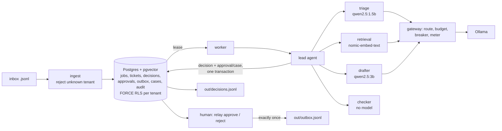

# Project Relay

A small multi-agent support desk for two tenants (Northwind Cycles, Harbor Dental). A lead agent plans
each ticket and hands work between a triage agent, a retrieval agent and a drafter through typed
contracts. A deterministic checker gates every draft, and **nothing reaches a customer until a human
approves it**. Everything runs on free local models (Ollama), with tenant isolation enforced by
Postgres row-level security that fails closed. The system measures itself with `make eval`.



Details: [docs/ARCHITECTURE.md](docs/ARCHITECTURE.md) · trade-offs: [docs/DECISIONS.md](docs/DECISIONS.md) ·
numbers: [docs/EVAL.md](docs/EVAL.md) · operations: [docs/RUNBOOK.md](docs/RUNBOOK.md) ·
[docs/LIMITATIONS.md](docs/LIMITATIONS.md) · [docs/AI_USAGE.md](docs/AI_USAGE.md)

## Quickstart (from a clean clone)

Prerequisites (Section 3 of the brief): Docker, Python 3.11+, [uv](https://docs.astral.sh/uv/), and
Ollama running with the three models pulled:

```bash
ollama pull qwen2.5:1.5b && ollama pull qwen2.5:3b && ollama pull nomic-embed-text
```

Then:

```bash
git clone <this repo> && cd <repo>
make demo
```

`make demo` does the following:
1. Starts Postgres (`docker compose up -d --wait`, host port **5433**).
2. `relay doctor` checks Postgres and the three Ollama models.
3. Runs migrations, creating the non-superuser `relay_app` role and the RLS policies.
4. Seeds both KBs with embeddings.
5. Processes both inboxes and writes `out/decisions.jsonl`.
6. Prints the approval queue and the next commands.

No `.env` is needed: every setting has a safe default ([.env.example](.env.example)).

Then act as the human approver:

```bash
uv run relay list                                   # approval queue + open cases
uv run relay show NW-T01                            # ticket, decision, why, draft, audit trail
uv run relay approve NW-T01 --by alice              # writes out/outbox.jsonl exactly once
uv run relay reject HD-T09 --reason "add the hours" # redrafts once; a second reject escalates
uv run relay show NW-T07                            # an injection: flagged, escalated, never obeyed
```

Other commands:

```bash
make run INBOX=data/edge/tickets.jsonl   # any inbox in the Appendix B format; re-running adds nothing
make eval RUNS=5                         # writes eval/runs/run_N.jsonl and docs/EVAL.md
make test                                # pytest, fake model, no Ollama needed
uv run relay report --view internal      # runs, models, tokens, latency, queue, cases
uv run relay report --view client --tenant harbor
CHAOS_FAIL_RATE=0.3 make run INBOX=...   # watch retries, breaker and fallback recover
```

### Without make (e.g. Windows without WSL)

Every target is a thin wrapper. The equivalent of `make demo`:

```bash
docker compose up -d --wait
uv sync
uv run relay demo
```

## Tested on

Samsung Galaxy Book laptop (750QGK): Intel Core 7 150U (10 cores / 12 threads), 16 GB RAM, **no GPU**
(Ollama on CPU). Windows 11 Pro, Docker Desktop (WSL2 backend), Ollama 0.40.12 native on Windows,
Python 3.12, uv 0.12.

| Step | Time |
|---|---|
| `make demo` from an empty database volume (models already pulled) | **248 s** for the final run. Earlier clean runs took 349 s, and one took 1,181 s because a single Ollama call stalled for about 12 minutes (laptop throttling); it was recorded as a `timeout` and the gateway fell back. |
| Per ticket | Triage about 3 s, drafting about 8–17 s; escalations finish in 3–5 s because nothing is drafted. |
| `make eval RUNS=5` | About 85 s per run plus about 70 s of injection probes, roughly 9 minutes in total. |
| `make test` | About 15 s. |

On Linux or macOS with `make`, expect similar times. A GPU makes drafting several times faster.

## Status

| ID | Requirement | Status | Notes |
|---|---|---|---|
| C1 | One command from a clean clone | done | `make demo` (or the 3 commands above). |
| C2 | Lead agent, 3 sub-agents, typed contracts, repair + classified failure | done | `relay/lead.py`, `relay/agents.py`, `relay/contracts.py`; schema-constrained output, one repair, then `invalid_json` / `schema_violation`. |
| C3 | pgvector retrieval over the current tenant only | done | RLS plus an explicit tenant filter; tested. |
| C4 | Deterministic checker | done | All six rules from the brief, plus: money promises, internal-text shingles, and every number must come from a passage or the ticket. One test per rule. |
| C5 | Approval CLI, exactly-once outbox, reject → redraft once, audit | done | DB-enforced uniqueness; every transition audited with who, when, what and why. |
| C6 | RLS, non-superuser role, FORCE, fail closed, test | done | `tests/test_isolation.py`. |
| C7 | `out/decisions.jsonl`, `make run INBOX=`, no duplicates on re-run | done | Files regenerated from the DB. |
| E1 | Gateway: routing, metering table, per-ticket/per-run budgets → `held_budget` | done | `model_calls` table; budget checked before every call. |
| E2 | Durable queue: leases, SKIP LOCKED, idempotency, backoff + jitter, dead letter → cases | done | Kill-and-resume tested. |
| E3 | `make eval RUNS=5` | done | Includes an injection probe set; see [docs/EVAL.md](docs/EVAL.md). |
| E4 | pytest without Ollama | done | 59 tests on a fake model, about 15 s. |
| S1 | Circuit breaker + fallback model, `CHAOS_FAIL_RATE` | done | Per-model breaker; tested. |
| S2 | Internal and client report views | done | CLI only, no web page. |
| S3 | GitHub Actions CI | done | `.github/workflows/ci.yml`; not yet run on GitHub at the time of writing. |
| S4 | Scaling note | done | [docs/DECISIONS.md §9](docs/DECISIONS.md). |

## Assumptions

- **Port.** Postgres runs from this repo's `docker-compose.yml` on host port **5433**, so it doesn't clash with
  a local Postgres or the brief's `relay-pg` setup container on 5432.
- **Status field.** `decisions.status` uses only the four Appendix B values. What the human did (approved,
  rejected, sent) lives in `approvals` and `outbox`, and in `relay show`. A ticket rejected twice becomes
  `escalated`. A ticket that exhausts its retries gets a `failed` decision, so `decisions.jsonl` always has
  one row per accepted ticket.
- **Rejected input.** Unknown-tenant and malformed lines are not in `decisions.jsonl` (they have no valid
  tenant). They go to `rejected_inputs` and `out/rejected_inputs.jsonl`, with a reason and a hash, not the text.
- **Ticket identity.** A ticket is identified by (tenant, id). Re-sending the same ID is a duplicate and is
  ignored, even if the text changed.
- **Escalations.** These draft nothing (no holding reply). `kb_refs` on an escalation lists the best
  covering public article (for the human's context), or nothing for the `other` category.
- **Language.** Replies are drafted in English, also for Hinglish tickets.
- **Re-running a single inbox** only processes new tickets. To see the whole demo from scratch:
  `make clean-db && make demo` (this deletes the database volume).
- **Injection probes.** `data/probes/injection_probes.jsonl` (16 tickets) was written for this project to
  measure the injection detector. It is used only by `make eval`.

## Time spent

About 2.5 hours of build time from the `start` commit, plus setup beforehand (installing Ollama and pulling
the models). The commit history shows the timeline. The build was done with an AI coding agent;
see [docs/AI_USAGE.md](docs/AI_USAGE.md).
