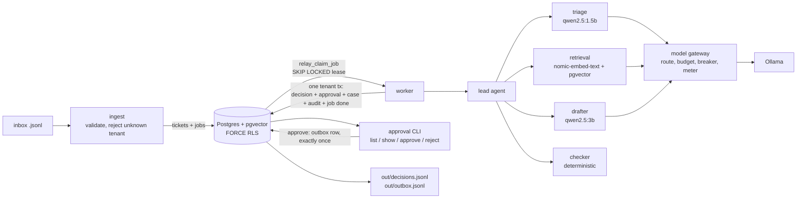
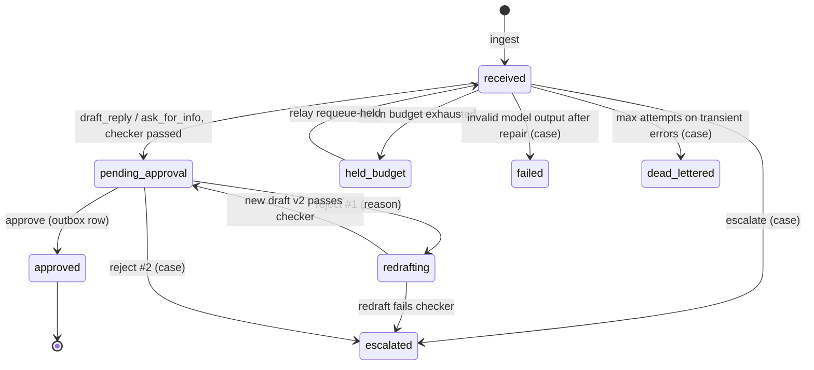

# Architecture

## Components

| Module | Job |
|---|---|
| `relay/ingest.py` | Validates each line against the `Ticket` contract, rejects unknown tenants and bad lines into `rejected_inputs`, stores tickets, enqueues one `process` job per ticket (idempotency key `process:<tenant>:<id>`). |
| `relay/queue.py` | Lease, complete, retry with full-jitter exponential backoff, dead-letter into `cases`. |
| `relay/worker.py` | Claims jobs, runs the lead agent, commits the outcome atomically. |
| `relay/lead.py` | Lead agent: plans the steps, routes between sub-agents, applies the business rules, builds the decision record. |
| `relay/agents.py` | Triage, retrieval and drafter sub-agents. |
| `relay/checker.py` | Deterministic draft checker (no model). |
| `relay/gateway.py` | The only code that calls a model. |
| `relay/approval.py` | Human approval state machine. |
| `relay/evaluate.py` | `make eval`. |
| `relay/report.py` | Internal and client views. |

## Agents and contracts

Contracts are Pydantic models in `relay/contracts.py`. The gateway passes each one's JSON schema to Ollama
as `format`, so the model is constrained to it, then validates the reply with `model_validate_json`.
If validation fails, it makes one repair call that includes the validation error. A second failure raises
`InvalidOutput` with a class (`invalid_json` or `schema_violation`). The ticket is then recorded as
`failed`, with a case. No model output is parsed with regexes.

| Agent | Sees | Never sees | Returns |
|---|---|---|---|
| Lead (`lead.run`) | ticket, sub-agent outputs, budget state (`CallContext`) | | `Outcome` → `Decision` |
| Triage | ticket subject and body (truncated to 4,000 chars), inside `<ticket>` delimiters | the KB | `TriageResult`: category, priority, injection_suspected, money_dispute, proposed_action, missing_details, reason |
| Retrieval | ticket text, a transaction bound to the ticket's tenant | other tenants' rows (RLS) | `list[Passage]` {kb_id, title, text, score, internal} |
| Drafter | ticket, **public** passages only, task (reply / ask for X / acknowledge), checker or reviewer feedback | internal articles: `agents.draft` filters them itself and does not trust the caller | `DraftResult`: reply, cited_kb_ids |
| Checker | draft, ticket, own KB IDs, own internal text shingles, other tenants' names, **hashes** of other tenants' KB shingles | other tenants' text | `CheckResult`: passed, reasons |

### How the lead agent decides (`lead.route`, a pure function)

1. Triage proposes a category, priority, action and flags.
2. Retrieval is used as a second classifier. If the best KB article beats the runner-up by at least
   `RETRIEVAL_CATEGORY_MARGIN`, that article's category (from `data/<tenant>/policy.json`) replaces the
   model's. Internal articles take part here because the brief allows them to inform routing. A model
   "clinical" label is only overridden when no clinical term is present.
3. Deterministic signals can only make the outcome safer:
   - **injection:** structural score ≥ 3, or the model flag together with a score ≥ 1 → escalate
   - **clinical terms (Harbor):** category clinical → escalate
   - **legal threat or money dispute:** escalate
   - **missing required detail** (order ID, patient identity, consent for a third party's records): ask_for_info
4. Otherwise, follow the model's escalate proposal. If the category is `other`, escalate when the ticket asks for
   something and acknowledge when it doesn't. Escalate if the best public passage is below `RETRIEVAL_MIN_SCORE`.
   If none of that applies, draft a reply.
5. Priority rules from the brief:
   - legal threat, safety words or severe clinical symptoms → urgent
   - "urgent" without that evidence is capped at high
   - injection or money dispute → at least high
   - an order change (time-sensitive) or a third-party records request → high
   - a normal-priority draft with no order or patient reference → low (general information)

For `draft_reply` and `ask_for_info`, the lead agent gives the drafter at most two public passages that score
within 0.03 of the best match (small models mix up loosely related passages), then calls the checker.
Checker rules:
- cited IDs exist in this tenant's KB and are public
- no canary code and no internal text
- no other tenant's name or content
- no clinical or medication language (Harbor)
- 150 words at most
- no IDs that are not in the ticket
- every number comes from a passage the drafter saw, or from the ticket
- no money promises

The lead agent calls the drafter and then the checker. On failure it redrafts
once, passing the checker's reasons. A second failure means escalation (case source `checker`).

## Data model

All tenant tables have `tenant_id` and the same RLS policy.

| Table | Key | Purpose |
|---|---|---|
| `tenants` | id | Directory (not tenant data). |
| `kb_articles` | (tenant_id, id) | KB with `vector(768)` embeddings. |
| `kb_fingerprints` | | md5 of 5-word shingles, filled by a trigger. relay_app has **no** grant on it. |
| `tickets` | (tenant_id, ticket_id) | Ticket and its `state`, `rejection_count`. |
| `decisions` | (tenant_id, ticket_id) | One decision per ticket, ever. `trace` (DB only) records each agent step. |
| `approvals` | (tenant_id, ticket_id, version) | Every customer-facing text; partial unique index allows one `pending` per ticket. |
| `outbox` | UNIQUE (tenant_id, ticket_id), UNIQUE idempotency_key | Approved messages. |
| `cases` | UNIQUE (tenant_id, ticket_id, source) | Escalations and dead letters: owner, severity, reason. |
| `audit_log` | | Who, when, what (action, from/to state), why (reason, details). |
| `model_calls` | | Every model attempt: task, model, tokens in/out, latency, ok, error class. |
| `jobs` | UNIQUE idempotency_key | Queue: status, attempts, max_attempts, run_after, lease_until, leased_by. |
| `runs` | run_id | Run token counter and budget (not tenant data). |
| `rejected_inputs` | UNIQUE (source, sha256) | Unknown-tenant and malformed lines (hash only, not the text). |

## Ticket state machine

`decisions.status` is the Appendix B status (`pending_approval`, `escalated`, `held_budget`, `failed`). The
human outcome lives in `approvals` and `outbox`. A dead-lettered ticket gets a `failed` decision row, so
`decisions.jsonl` always has one row per accepted ticket.

## How isolation works

- The app connects as `relay_app`: `LOGIN NOSUPERUSER NOBYPASSRLS`, created by the migration runner.
  Migrations run as the superuser.
- Every tenant table has `ENABLE` and `FORCE ROW LEVEL SECURITY` and one policy:
  `USING / WITH CHECK (tenant_id = current_setting('app.tenant_id', true))`.
- `relay.db.tenant_tx(conn, tenant)` is the only way code touches tenant data. It opens a transaction and runs
  `set_config('app.tenant_id', tenant, true)`, which is transaction-local. A connection can't carry one
  tenant's setting into the next transaction.
- **Fails closed.** Without the setting, `current_setting(..., true)` is NULL and `tenant_id = NULL` is never
  true, so reads return zero rows and writes are rejected. `tests/test_isolation.py` proves this for every tenant table.
- **Cross-tenant needs** go through `SECURITY DEFINER` functions that return no tenant text:
  - `relay_claim_job` returns IDs only; the worker then opens a transaction for that job's tenant
  - `relay_foreign_fingerprints` returns hashes and raises if no tenant is set
  - `relay_queue_stats` returns counts
- Retrieval also adds `WHERE tenant_id = current_setting(...)` as belt and braces. The tests prove RLS alone holds.
- **Unknown tenants** are rejected at ingest (`rejected_inputs`, `out/rejected_inputs.jsonl`) and never stored as tickets.
- **Exports** are built per tenant through RLS. `relay report --view client --tenant X` reads only X.
